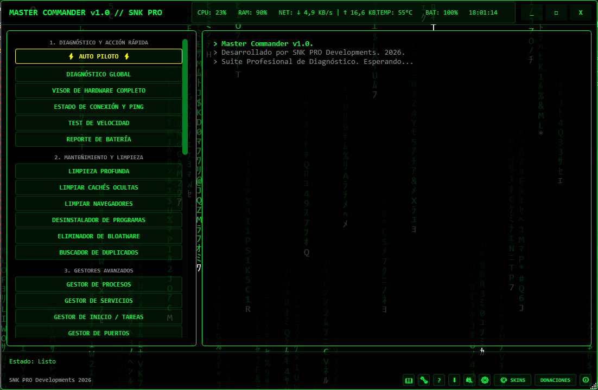
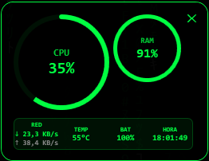
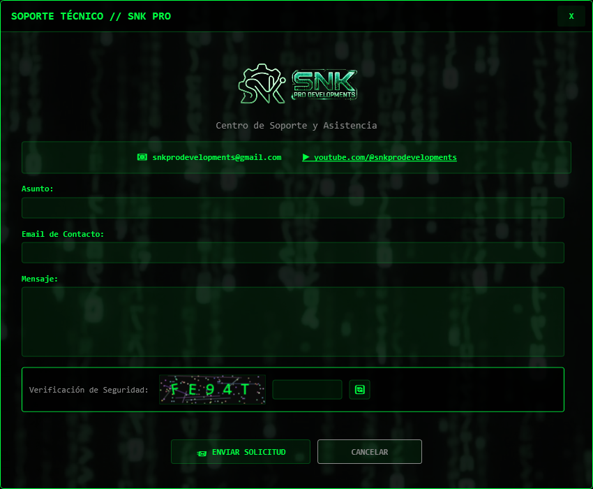
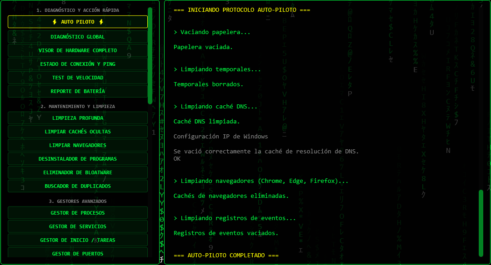

  
  
  # 🚀 MASTER COMMANDER
  
  **Suite Profesional de Diagnóstico, Optimización y Mantenimiento para Windows**
  
  
  
  
  
  

---

## 📖 Tabla de Contenidos
1. [Descripción General](#-descripción-general)
2. [Capturas de Pantalla](#-capturas-de-pantalla)
3. [Características Principales](#-características-principales)
4. [Instalación](#-instalación)
5. [Requisitos del Sistema](#-requisitos-del-sistema)
6. [Stack Tecnológico](#-stack-tecnológico)
7. [Apoya el Proyecto](#-apoya-el-proyecto)
8. [Licencia y Soporte](#-licencia-y-soporte)

---

## 📌 Descripción General

**Master Commander** es una potente suite de herramientas de diagnóstico, mantenimiento y optimización diseñada por **SNK PRO Developments** para técnicos, entusiastas y usuarios avanzados de Windows. 

El software centraliza decenas de comandos nativos, scripts de PowerShell y utilidades WMI/CIM en una interfaz gráfica estilizada con una temática **Cyberpunk/Matrix** (verde neón sobre fondo oscuro). Para garantizar la seguridad, incluye un **Modo Simulación** activado por defecto, barreras de doble confirmación para acciones destructivas y un sistema de logs que audita cada cambio.

---

## 🖥️ Capturas de Pantalla

| Interfaz Principal (Matrix Rain) | Widget Flotante (HUD en tiempo real) |
| :---: | :---: |
|  |  |

| Módulo de Soporte Técnico | Gestor de Herramientas |
| :---: | :---: |
|  |  |

---

## ✨ Características Principales

<b>🔍 Diagnóstico y Acción Rápida (Haz clic para expandir)</b>

 

- **Auto Piloto:** Ejecuta una limpieza básica automática (Papelera, Temporales, DNS).
- **Diagnóstico Global:** Analiza el espacio en disco y el estado de Windows Defender.
- **Visor de Hardware:** Muestra información detallada de CPU, RAM, GPU y discos.
- **Test de Velocidad:** Mide bajada y subida de red usando Cloudflare.
- **Reporte de Batería:** Muestra estado, carga y tiempo restante (en portátiles).

<b>🧹 Mantenimiento y Limpieza Profunda</b>

 

- **Limpieza Profunda:** Borra temporales, vacía la papelera y desactiva la hibernación.
- **Cachés Ocultas:** Limpia la caché de miniaturas de Windows y el DNS.
- **Limpiar Navegadores:** Elimina caché de Chrome, Edge y Firefox.
- **Desinstalador de Programas:** Lista programas, muestra última fecha de uso y permite desinstalar.
- **Eliminador de Bloatware:** Desinstala apps preinstaladas de la Microsoft Store (Xbox, Skype, etc.).
- **Buscador de Duplicados:** Encuentra archivos idénticos por hash MD5 y ordénalos por fecha para eliminarlos.

<b>⚙️ Gestores Avanzados del Sistema</b>

 

- **Gestor de Procesos:** Lista procesos con mayor consumo de RAM. Permite matar procesos o árboles de procesos.
- **Gestor de Servicios:** Inicia o detiene servicios de Windows.
- **Gestor de Inicio:** Administra programas de inicio y tareas programadas.
- **Gestor de Puertos:** Muestra puertos TCP (LISTEN/ESTABLISHED) y permite cerrar el proceso asociado.

<b>🛡️ Red, Seguridad y Sistema</b>

 

- **Módulo de Red:** Configura DNS (Cloudflare, Google, DHCP) y adaptadores activos.
- **Reparar Red Total:** Limpia DNS, resetea Winsock y TCP/IP.
- **Escaneo de Seguridad:** Actualiza firmas de Defender y ejecuta un escaneo rápido.
- **Auditor Firewall/Updates:** Muestra el estado del Firewall y Windows Update.
- **Reparación SFC/DISM:** Ejecuta reparaciones de archivos del sistema corruptos.
- **Backup del Registro:** Exporta claves HKLM y HKCU a un archivo `.reg`.

---

## 📥 Instalación

Para instalar Master Commander, sigue estos pasos:

1. Ve a la sección de **[Releases](https://github.com/nicolasgustavoramos/MasterCommander/releases)** en este repositorio.
2. Descarga el archivo **`MasterCommander_Setup_v1.0.0.exe`** (Instalador) o el **`.zip`** (Versión Portable).
3. Ejecuta el instalador. *(El programa requiere permisos de Administrador)*.
4. Acepta los términos y condiciones, y elige el tipo de instalación.

> ⚠️ **Advertencia de SmartScreen:** Al ser un desarrollador independiente sin certificado de firma comercial (EV), Windows SmartScreen puede mostrar una advertencia de seguridad. Para instalar, haz clic en **"Más información"** y luego en **"Ejecutar de todos modos"**. El código es 100% seguro y de código abierto.

---

## 💻 Requisitos del Sistema

| Componente | Mínimo | Recomendado |
| :--- | :--- | :--- |
| **Sistema Operativo** | Windows 10 (v1607) | Windows 11 (Última versión) |
| **Framework** | [.NET 9 Desktop Runtime](https://dotnet.microsoft.com/download/dotnet/9.0) | .NET 9 Desktop Runtime |
| **Espacio en Disco** | 50 MB | 500 MB (Para logs y reportes) |
| **Memoria RAM** | 2 GB | 4 GB o superior |
| **Permisos** | Administrador (UAC) | Administrador (UAC) |

---

## 🛠️ Stack Tecnológico

Este proyecto fue construido utilizando las siguientes tecnologías:

- **Lenguaje:** C# / WPF (Windows Presentation Foundation)
- **Framework:** .NET 9
- **Generación de Reportes:** QuestPDF (Licencia Community)
- **Scripts de Sistema:** PowerShell, WMI, CIM, CMD
- **Empaquetado e Instalación:** Inno Setup 6
- **Actualizaciones OTA:** GitHub API + HttpClient

---

## ❤️ Apoya el Proyecto

Este proyecto es gratuito y de código abierto. Si te resulta útil y deseas apoyar el desarrollo de herramientas independientes, puedes hacerlo a través de:

- **PayPal:** [Donar aquí](https://www.paypal.com/paypalme/elmundodewilson)
- **Mercado Pago:** Alias `ngr.mp` (Argentina)
- **Binance Pay:** ID `ElmerVanHess`

---

## 📞 Licencia y Soporte

Este proyecto está bajo la **Licencia MIT**. Consulta el archivo [LICENSE](LICENSE) para más detalles.

- **Desarrollador:** Nicolás Gustavo Ramos (SNK PRO Developments)
- **Email de Soporte:** snkprodevelopments@gmail.com
- **Canal de YouTube:** [@snkprodevelopments](https://www.youtube.com/@snkprodevelopments)
- **Sitio Web Oficial:** [GitHub Pages](https://nicolasgustavoramos.github.io/MasterCommander/)

---

  <i>Desarrollado con ❤️ por <b>SNK PRO Developments</b> © 2026</i>

